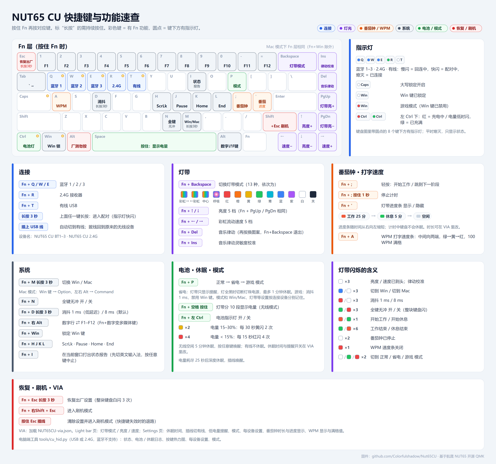

# Nut65CU

维咖（Weikav）**NUT65 CU**（纯铜版，无单键 RGB，8 颗指示灯 + 80 颗灯带）的自制 QMK 固件。
基于方案商航晟（hangshengkeji）开源的普通版 NUT65 QMK 源码移植，修复了原厂代码中的多个问题，并加入番茄钟、打字速度条、省电 / 游戏模式、每设备设置、电池与休眠日志、按键热力图等功能。



> 说明书矢量版：[docs/manual.svg](docs/manual.svg)（由 `tools/gen_manual.py` 生成）

## 功能

- 三模连接：蓝牙 ×3、2.4G、有线；**插上 USB 线自动切有线，拔线回到原无线设备**
- 原厂 13 种灯带模式，亮度 5 档、彩虹流速 5 档；保留板载音乐律动
- **番茄钟**：灯带进度条，工作 / 休息自动切换，时长可在 VIA 调整，计时期间不休眠
- **WPM 打字速度条**：从中间向两端，绿 → 黄 → 红
- **低电量提醒**：电量低于 30% / 15% 时灯带定时闪烁
- 8 颗指示灯只显示状态：连接、大写、Win 锁、电池
- **正常 / 省电 / 游戏模式**（Fn+P）：省电模式灯全黑时切断灯珠电源、最多 1 分钟休眠；游戏模式消抖 1 ms、禁用 Win 键
- **每设备设置**：USB、各蓝牙、2.4G 分别记住模式、Win/Mac、Win 锁、全键无冲、数字行和灯带
- **电池 / 休眠日志**与**按键计数**存在键盘的外部 Flash，用电脑端工具读出（USB 或 2.4G）
- **Fn+I** 在当前窗口打出状态报告（固件版本、连接、电量、模式等）
- VIA 支持：改键、宏，以及灯带与各项功能的设置菜单
- 所有整条灯带的显示都限制了亮度，避免升压电路啸叫

相对原厂源码的完整改动见 [docs/CHANGES.md](docs/CHANGES.md)。

## 刷机

固件在 [`firmware/`](firmware/)：

| 文件 | 用途 |
|---|---|
| `leku_nut65cu_default.bin` | 正式固件 |
| `leku_nut65cu_ledtest.bin` | 灯珠测试固件（逐颗点亮，用于核对灯链） |
| `NUT65CU-via.json` | VIA 配置文件（VIA → Settings → Design → Load） |
| `SHA256SUMS.txt` | 校验值 |

1. 有线连接（Fn+T），按 **Fn + 右Shift + Esc** 进入刷机模式（键盘灯全灭，设备变为 `342D:DFA0`）。
   已经刷了本固件时，也可以按住 Esc 再插线进入（会同时清除设置）。
2. Windows 首次需要安装 WB32 DFU 驱动（见 [WestberryTech/wb32-dfu-updater](https://github.com/WestberryTech/wb32-dfu-updater)）。
3. 用 `wb32-dfu-updater_cli`（[QMK MSYS](https://msys.qmk.fm/) 自带）刷写并复位：

   ```
   wb32-dfu-updater_cli -t -s 0x08000000 -D leku_nut65cu_default.bin
   wb32-dfu-updater_cli -R
   ```

4. 从其他固件刷过来时，第一次启动会自动恢复出厂设置一次；之后刷新版本会保留本固件的设置。
   注意 VIA 的改键与宏以编译日期校验，刷入不同日期编译的固件时会恢复默认键位，需要的话先在 VIA 里导出备份。

**刷机前强烈建议先备份原厂固件**（只读，不要加 `-t`）：

```
wb32-dfu-updater_cli -s 0x08000000 -U nut65cu_stock_backup.bin -Z 262144
```

WB32 的 ROM bootloader 不会被覆盖，刷坏了也能重新进入刷机模式恢复。本仓库不提供原厂固件。

## 从源码编译

```
git clone https://github.com/hangshengkeji/qmk_firmware.git
cd qmk_firmware
git checkout 3164abd3
git submodule update --init --depth 1 lib/chibios lib/chibios-contrib lib/printf lib/lufa lib/vusb
cp -r ../Nut65CU/keyboards/leku/nut65cu keyboards/leku/
git apply ../Nut65CU/patches/oem-shared-fixes.patch
make leku/nut65cu:default
```

在 Windows 上使用 QMK MSYS 编译；构建目录路径不要太长。

## 电脑端工具

`tools/cu_hid.py`：Windows 上直接用 Python 运行，无需安装依赖；键盘需用 USB 或 2.4G 连接（蓝牙下无线模块不转发，用不了）。

```
python tools/cu_hid.py info                  # 连接、电量、模式、外部 Flash
python tools/cu_hid.py log --csv log.csv     # 电池 / 休眠 / 连接日志
python tools/cu_hid.py keys --svg map.svg    # 按键热力图
python tools/cu_hid.py profile               # 每设备设置
python tools/cu_hid.py mode eco              # 切换模式：normal / eco / game
```

## 仓库结构

| 路径 | 内容 |
|---|---|
| `keyboards/leku/nut65cu/` | 键盘源码（keymap：`default`、`ledtest`） |
| `patches/oem-shared-fixes.patch` | 对原厂共享代码的修复（无线接收越界、Pixel Fractal 越界、Raw HID 按来源回复、模块收发计数） |
| `firmware/` | 编译好的固件与 VIA 配置 |
| `docs/` | 说明书、改动清单、硬件资料 |
| `tools/` | 电脑端工具 `cu_hid.py`、说明书生成脚本、从固件中读取引脚表 / 灯珠表的分析脚本 |

## 致谢

- [hangshengkeji/qmk_firmware](https://github.com/hangshengkeji/qmk_firmware)：NUT65 原厂 QMK 源码
- [MoonZhe/Nut65](https://github.com/MoonZhe/Nut65)：原厂代码问题的分析与修复（刷机清设置、休眠唤醒、消抖、越界等），`hs_debounce.c` 来自该项目
- [QMK](https://qmk.fm/)、[VIA](https://www.caniusevia.com/)

## 许可

GPL-2.0-or-later，与 QMK 相同，见 [LICENSE](LICENSE)。

非官方项目，与维咖 / LEKU / 航晟无关。刷写第三方固件风险自负。
